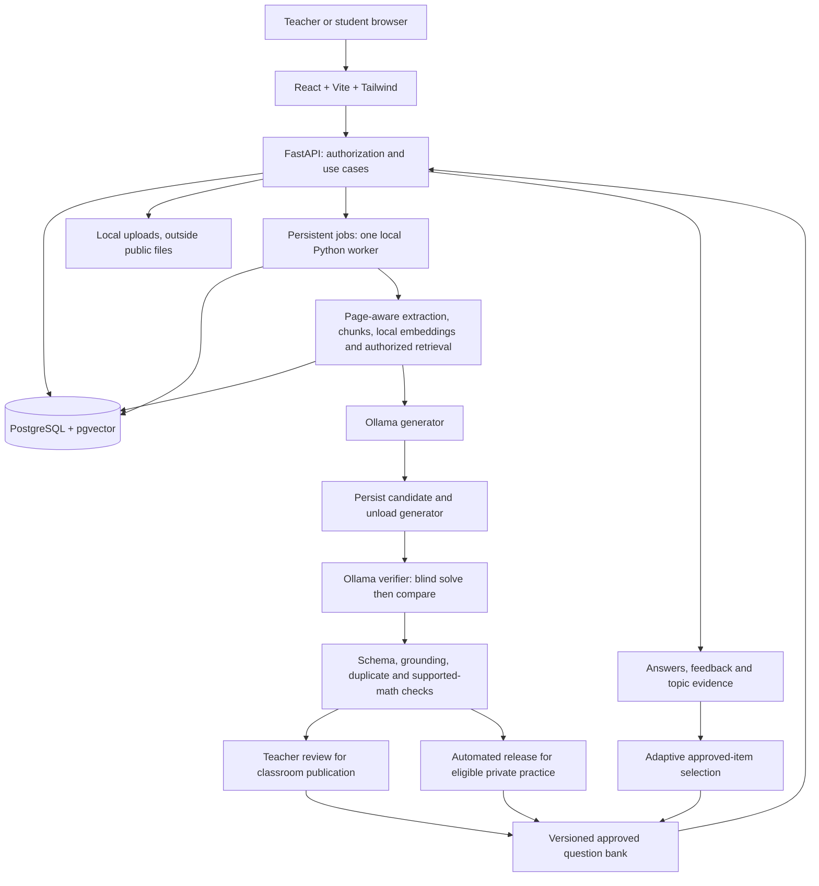
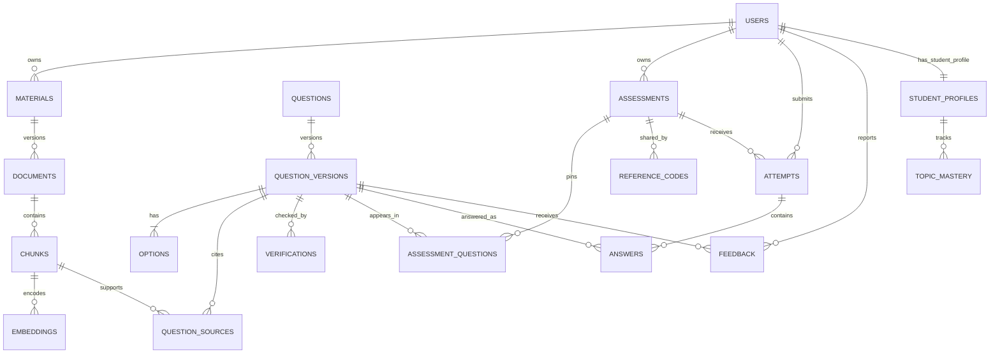

# Phase 1 architecture and decision record

> Current handover: [documentation index](README.md), [setup guide](setup-guide.md), [user guide](user-guide.md) and [limitations](limitations.md). This module reference preserves its phase-specific history. Later implementation and Phase 22 native setup supersede earlier planned/pending statements and partial bootstrap instructions. Use the current guides for everyday operation.

Baseline 1.0. The interfaces in this document are planned contracts. They are not live APIs or application code.

## Components and information flow

Retrieval filters permissions before selecting context. The API owns scoring and release policy. Neither browser nor LLM receives database credentials. The generator/verifier cannot call arbitrary tools, install packages or execute document instructions. Local inference uses the loopback Ollama service; the frontend calls only FastAPI.

## Decisions and reasons

| ID | Baseline decision | Why / consequence |
|---|---|---|
| A01 | Native local services, no mandatory Docker/cloud | Conserves resources and meets the ₹0 local-only constraint |
| A02 | One PostgreSQL store with pgvector | Transactions, ownership and embeddings share a manageable local data service |
| A03 | One persistent Python worker, PostgreSQL job table | Long CPU tasks do not block requests or require another queue service |
| A04 | Sequential generator and verifier model residency | 8 GB RAM includes Windows, browser, database and Python; two resident models are not assumed feasible |
| A05 | Separate blind-solve and comparison review | Reduces answer anchoring while recording disagreement; does not guarantee independence |
| A06 | Pydantic plus deterministic math/source/duplicate gates | A model verdict alone is insufficient for release |
| A07 | Immutable question versions and assessment snapshots | Editing cannot silently change completed or active tests and invalidate audit evidence |
| A08 | Teacher review for classroom, explicit automatic checking for practice | Preserves teacher publication authority without requiring reference codes for private practice |
| A09 | Topic/difficulty evidence with minimum observations and hysteresis | Avoids unstable difficulty jumps and makes the rule testable |
| A10 | Feedback changes review and versioned rules, not weights | Ordinary feedback handling needs no training hardware and makes no false training claim |
| A11 | Direct Python RAG first, exact vector search on small corpus | Fewer dependencies and simpler permission/recall testing before scale optimizations |
| A12 | Authentication plus object ownership, code is a locator | Possessing a classroom code does not grant unrestricted object access |
| A13 | All model/package versions pinned at installation | Documentation candidates alone do not establish installed compatibility or reproducibility |

## Module boundaries

API routers validate requests, services own authorization and state changes, repositories own persistence, AI adapters own local requests, and independent validation/adaptive modules implement domain rules. Frontend features use a shared API client and authenticated route guards. Route guards are convenience controls; server authorization remains mandatory.

Generation jobs keep queued/running/cancelling/completed/failed states and stage progress. The worker claims a job transactionally and records a lease/heartbeat for recovery. Cancellation stops between safe stages, saves partial progress and does not publish partial unchecked sets. Recovery must not repeat scores or approvals. This job mechanism is implemented in later backend/AI phases.

## State and release contracts

Question versions progress through generated → validation pending → verified candidate → teacher review → approved. Failures are regenerate/rejected/review required. Publication pins approved IDs. An edit creates a new version and resets checks. Reusing an approved version preserves its provenance and eligibility. Quarantine blocks future selection but does not delete historical evidence.

Verifier public status is PASS, REGENERATE or REJECT. Its result includes confidence_score, correctness_score, clarity_score, difficulty_score, distractor_score, grounding_score and duplicate_score, each constrained to 0–100; issues and suggested_fix complete the requested contract. These are criterion signals, not calibrated probabilities. Define duplicate_score as estimated duplication risk: larger is worse, unlike positive quality ratings. A separate application review state records unsupported math, unresolved disagreements or human review needs; it does not become a misleading PASS. A later schema may allow unavailable scores to be null rather than inventing a value; such a result cannot satisfy automatic approval.

First verifier pass gets source, stem and options, with generator key/explanation withheld. It must identify zero/one/multiple defensible options. Comparison then checks the proposed key and explanation. Regeneration receives defect reasons and has a proposed maximum of two retries. Teacher edits re-run validation. Quality thresholds are configured only after development-set calibration.

Deterministic mathematics covers explicitly supported structured problems with stated domains/units/rounding. Exactly one option must match the independent result. Unsafe expressions, unknown assumptions, computation timeout or unsupported problem types require review and cannot pass automatically. The validator never guesses the nearest option.

## Conceptual data relationships

Only student users require student profiles; the diagram's profile relationship describes that subset. Course memberships, topics, jobs and audit events are additional normalized entities detailed in Phase 2. Private practice is an owner-scoped assessment/session without access codes. Analytics derive from answers, attempts and feedback. Phase 2 will specify fields, keys, indexes, optionality and migrations; Phase 1 creates no schema.

## Planned API boundaries

| Boundary | Planned contract | Sensitive behavior |
|---|---|---|
| Identity | /api/v1/auth and /me | Validated tokens and controlled roles |
| Material | /materials, process jobs | Owner-scoped upload, chunk and file access |
| Generation | /generation-jobs with progress/cancel | Input limits, local-only model calls and no key leakage |
| Review | /question-versions/{id}/verify, approve, reject | Current-version gate and audit trail |
| Publication | /assessments/{id}/publish and codes | Approved snapshot and atomic publication |
| Student work | joins, attempts, answers and submit | Eligibility, stable option IDs and idempotency |
| Personalization | /practice-sessions, /me/mastery | First valid evidence and reproducible selection |
| Quality/research | feedback, analytics and evaluation exports | Authorized scope, anonymization and provenance |

These are boundaries rather than a final OpenAPI document. No endpoints are added during Phase 1. Planned ports are frontend 5173, FastAPI 8000, PostgreSQL 5432 and Ollama 11434. Bind locally. No answer keys, explanations or revealing source excerpts are sent before result release in a restricted classroom test.

## Configuration and resource plan

The [.env.example](../.env.example) defines names intended for future configuration loading. It has no operational effect now. Application variables and Ollama-process variables are clearly separated. Ollama cloud-disable settings must be passed to the Ollama process and verified; merely placing them in the backend environment file is insufficient.

Start with one MCQ per call, a 2,048-token total context, an explicitly reserved 512-token output budget and up to three short chunks. The later worker must budget prompt/schema/source/options/output together and reduce retrieved context if needed. These are tunable feasibility defaults. The MiniLM tokenizer limit also governs chunk size; do not confuse its input budget with the LLM context budget. Free up ingestion/embedding memory before inference if measurements require it.

Same-model two-role operation is a separately labelled fallback experiment, never falsely described as independent-model validation. If small-model quality is inadequate, narrow supported question classes and increase teacher review. No cloud fallback is permitted.
