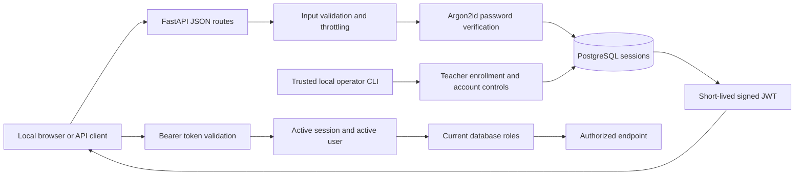

# Authentication and roles — Phase 4

> Current handover: [documentation index](README.md), [setup guide](setup-guide.md), [user guide](user-guide.md) and [limitations](limitations.md). This module reference preserves its phase-specific history. Later implementation and Phase 22 native setup supersede earlier planned/pending statements and partial bootstrap instructions. Use the current guides for everyday operation.

Implemented locally: student registration, login, current-user profile, short-lived bearer tokens, persistent session revocation, logout, logout-all, password change, teacher/student role checks, local operator account management, and database-backed authentication throttling.

Dashboards, course ownership checks in feature endpoints, assessment access and AI workflows remain later phases. The role-check routes are diagnostic gates, not completed dashboards. Native Windows PostgreSQL deployment and password authentication still need validation on the installed server.

## Architecture and trust boundaries



The API is the identity and authorization boundary. Clients never supply trusted roles. Registration accepts no `role`, `roles`, `active`, password-hash or session-ID field. A restricted database function creates a student user, student role, profile and audit event atomically. A duplicate email returns a conflict without creating another role/profile or changing the existing account.

The runtime database login has no direct ability to insert/update/delete `user_roles`, insert users, or update account activation. Teacher enrollment requires the trusted local schema-owner login through the operator command. This separation is checked by readiness and by tests. A compromised database owner remains outside that application permission boundary.

## Passwords and tokens

- Argon2id uses 19,456 KiB memory, two iterations, one lane and a fresh random salt. At most two hash/verify operations run concurrently per backend process. These settings follow the [OWASP Argon2id minimum recommendation](https://cheatsheetseries.owasp.org/cheatsheets/Password_Storage_Cheat_Sheet.html) and use [argon2-cffi](https://argon2-cffi.readthedocs.io/en/stable/howto.html). Hashing latency on the student's full application stack has not been benchmarked.
- New passwords contain 12–128 characters; passwords are not trimmed or silently normalized. Login accepts 1–128 characters to validate an existing password. This is a length policy, not a breached-password screening service.
- Unknown accounts perform a dummy Argon2 verification. Unknown, disabled, roleless and wrong-password logins return the same generic 401 response. No constant-time network behavior is claimed.
- JWTs use a fixed HS256 allowlist. Required claims are `sub`, `jti`, `iat`, `nbf`, `exp`, `iss`, `aud` and `token_type=access`. The issuer is `adaptive-mcq.local`; audience is `adaptive-mcq-api`. Signature, time claims, claim types and UUID identities are checked with [PyJWT](https://pyjwt.readthedocs.io/en/stable/usage.html).
- Lifetime defaults to 15 minutes, configurable from 5 to 30. There is no refresh token. Sign in again after expiry. The database independently checks session expiry and revocation on every protected request.
- Roles are read from PostgreSQL for every protected request. No role supplied by a client or embedded in a JWT grants authority.
- Tokens are returned only on login. The database stores session IDs/timestamps, not complete JWTs or plaintext passwords. Responses containing identity/token data have `Cache-Control: no-store`.

Use a stable random private `JWT_SECRET` of at least 32 characters. Generating a new secret on each normal startup invalidates all existing tokens and changes throttling keys. Deliberate secret rotation invalidates old tokens but is not an automated key-rotation feature. No real secret or pre-created account is shipped.

The frontend holds access tokens in memory and sends them in the `Authorization` header. Tokens are not placed in URLs, source files, logs or screenshots. Cookie sessions, persistent browser token storage, MFA, email verification and email-based password recovery are not implemented. An email address is a local account identifier; its ownership is not verified by this phase.

## API contracts

All payloads use JSON. Prefix: `/api/v1`. Errors retain the Phase 3 safe error envelope and server-generated request ID.

| Method and route | Request / authorization | Result |
|---|---|---|
| POST `/auth/register` | `email`, `display_name`, `password`; no bearer required | 201 public profile with only `student` role; duplicate 409; invalid/extra fields 422 |
| POST `/auth/login` | `email`, `password` | 200 `access_token`, `token_type: bearer`, `expires_in`, public user; invalid credentials 401 |
| GET `/auth/me` | Bearer token | Own ID, email, display name, current roles and created time |
| POST `/auth/logout` | Bearer token | 204; revokes this session immediately |
| POST `/auth/logout-all` | Bearer token | 204; revokes all sessions belonging to this user |
| POST `/auth/change-password` | Bearer plus `current_password`, `new_password` | 204; hash replaced and every session revoked atomically; user must sign in again |
| GET `/roles/student` | Active bearer session and student role | 200 role-check result; teacher-only account gets 403 |
| GET `/roles/teacher` | Active bearer session and teacher role | 200 role-check result; student-only account gets 403 |

A user with both roles can access both role gates. A user with no roles cannot obtain or use a session. Logout-all affects only the current user's sessions. A token already revoked by logout gets 401 on subsequent protected calls, including a second logout. Client code may treat that 401 as an already-ended session.

Error codes include `INVALID_CREDENTIALS` (401), `ROLE_REQUIRED` (403), `ACCOUNT_UNAVAILABLE` (409), `RATE_LIMITED` (429), `AUTH_UNAVAILABLE`/`DATABASE_UNAVAILABLE` (503), and `REQUEST_TOO_LARGE` (413). A 401 includes `WWW-Authenticate: Bearer`; a 429 includes `Retry-After`. Input-validation errors never return rejected password values. Public profiles never contain password hashes.

Example request shapes below are illustrations, not actual registered users:

```json
{"email":"student@example.com","display_name":"Student","password":"your-private-password"}
```

```json
{"email":"student@example.com","password":"your-private-password"}
```

After login, send `Authorization: Bearer <access_token>`. The local `/docs` page lists the implemented routes and links to their OpenAPI schema; it does not store tokens or provide a frontend login screen.

## Throttling and resource limits

Defaults use 15-minute windows:

| Scope | Limit |
|---|---|
| Login per direct client address | 30 attempts |
| Login per normalized email | 5 attempts |
| Registration per direct client address | 5 attempts |
| Password changes per authenticated user | 5 attempts |

Counters include successful and unsuccessful attempts and are committed before password work. The first request beyond the limit returns 429. Counters persist across API restarts. Expired windows reset atomically on the next request; blocked requests do not extend the current window. `X-Forwarded-For` is ignored. For the one-computer demonstration, clients commonly share a loopback address and therefore share its limits; use the documented bounded settings when planning a larger local demonstration.

Keys are HMAC digests, separated by operation. Raw emails/IP addresses are not stored in the rate-limit table. Registration conflict responses still reveal account availability through their status; the system does not claim complete account-enumeration resistance. Public registration is student-only, not invitation-only.

All non-upload API request bodies are limited to 16 KiB, including streamed bodies, with a 15-second receive deadline. Phase 21 also rejects disallowed browser origins before request processing and applies no-store to all API responses. JWT strings are limited to 4,096 characters. The API continues to bind loopback only. See the [security guide](security.md) for coverage and explicit limits. These controls are not a public-internet deployment security review or protection from a malicious administrator on the same computer.

## Database migration and runtime grants

Migration `003_auth.sql` adds:

- `mcq.auth_sessions`: user-linked session ID, creation/expiry and revocation timestamps. Identity/expiry cannot be rewritten; revocation cannot be undone.
- `mcq.auth_rate_limits`: hashed bucket key, attempt count and expiry.
- `mcq.register_student(text,text,text)`: a security-definer function with a fixed search path and qualified table names; PUBLIC execute permission is revoked. It accepts no role argument and creates a student only.

Migrations 001 and 002 are unchanged. No existing password, user role or assessment record is converted or overwritten. Accounts inserted previously with fake/non-Argon2 hashes cannot log in; migrations never invent passwords for them.

After preparing native PostgreSQL/pgvector, use the trusted migration-owner credentials to apply all migrations using the existing [migration guide](database.md). Then apply the separately reviewed grant script to an already-created restricted runtime login:

```powershell
& 'C:\Program Files\PostgreSQL\18\bin\psql.exe' -X -w -h 127.0.0.1 -d adaptive_mcq -U adaptive_mcq_migrator -v runtime_role=adaptive_mcq_app -f database/auth_runtime_grants.sql
```

Supply credentials through the protected local PostgreSQL password file or a private process environment. This command is documented but has not been run against the student's native database. The grant script does not create roles, passwords or the database, and does not remove pre-existing broad grants. Start with a restricted role; readiness rejects unsafe administrative rights or excessive account/role/session-update permissions. The script adds metadata reads, authentication-specific reads/writes, audit inserts and execute permission on the student-registration helper. It does not grant assessment/question access.

The new readiness check `auth_permissions` must be `ok`. Authentication operations fail closed with 503 if the schema, pgvector, runtime role or required authentication grants are not ready. Health liveness can still return 200.

Expired session and rate-limit rows are retained; automated retention cleanup is not implemented. An operator can establish a retention policy and remove expired authentication rows later without changing user/assessment records. Never delete active throttle windows to conceal abuse. No retention cleanup runs automatically in this phase.

## Teacher enrollment and account administration

Run the following commands in a separate local operator terminal from the project root. Set `DATABASE_USER`/`DATABASE_PASSWORD` to the trusted migration/schema-owner login in that terminal only. The running API must continue using `adaptive_mcq_app`.

```powershell
.\.venv\Scripts\python.exe -m backend.manage create-teacher --email teacher@example.com --name 'Teacher Name'
.\.venv\Scripts\python.exe -m backend.manage grant-teacher --email existing-student@example.com
.\.venv\Scripts\python.exe -m backend.manage revoke-teacher --email existing-student@example.com
.\.venv\Scripts\python.exe -m backend.manage disable-user --email student@example.com
.\.venv\Scripts\python.exe -m backend.manage enable-user --email student@example.com
```

Replace illustrative addresses/names with authorized real account details. `create-teacher` prompts for a password twice without accepting it as a command-line argument. It creates a teacher-only account; it does not silently convert an existing account. `grant-teacher` adds the teacher role to an existing account, preserving its student role. Role and activation changes revoke all of that account's sessions. Re-enabling does not revive old tokens. Removing the only role leaves an account unable to log in until an authorized role is restored.

All operations require schema-owner membership and use transactions. The restricted API login cannot run them. No teacher seed account, default password, API operator role or public role-assignment endpoint is included. Operator audit events identify the database actor separately from the target user; they do not falsely attribute an operator action to the student.

## Validation and boundaries

The backend tests exercise actual Argon2 hashing, JWT validation, JSON API contracts and database-backed flows through Psycopg/SQLAlchemy connected to disposable embedded PostgreSQL. They cover student-only registration, duplicate atomicity, role gates, teacher operations, session revocation across app recreation, password change, disabled accounts, fresh role lookup, throttling, runtime SQL restrictions and session-expiry/revocation constraints. Existing migration/backend tests remain part of regression validation.

PGlite's socket adapter cannot reliably process an extended-query SQL error followed by wire-level rollback. Expected SQL permission/constraint rejections are therefore asserted inside PostgreSQL exception blocks; the test fails if the rejection does not occur. Ordinary transaction commit/rollback and API errors are tested separately. Native driver recovery from aborted SQL transactions, native account authentication and real multi-connection races remain unverified. Test adapter role switching is not evidence of native PostgreSQL login behavior.

Run from the project root:

```powershell
.\.venv\Scripts\python.exe -m pip install -r backend/requirements-dev.txt
npm ci --prefix database/tests --ignore-scripts --no-audit --no-fund
$env:MCQ_RUN_DB_TESTS = '1'
.\.venv\Scripts\python.exe -m pytest backend/tests -q
.\.venv\Scripts\python.exe -m ruff check backend
.\.venv\Scripts\python.exe -m pip check
```

All new dependencies are FREE / OPEN SOURCE: argon2-cffi 25.1.0, PyJWT 2.15.1 and email-validator 2.3.0. Full transitive versions are pinned in the backend lockfiles. Email syntax validation does not send verification messages or use a paid service. See the [completion record](phase-4-completion.md) for actual check counts and remaining setup.

Resource ownership and membership authorization must be added alongside future protected feature endpoints. A teacher role alone must never grant access to another teacher's materials, and a student role must never grant access to another student's answers. No such resource endpoint is introduced in this phase.
