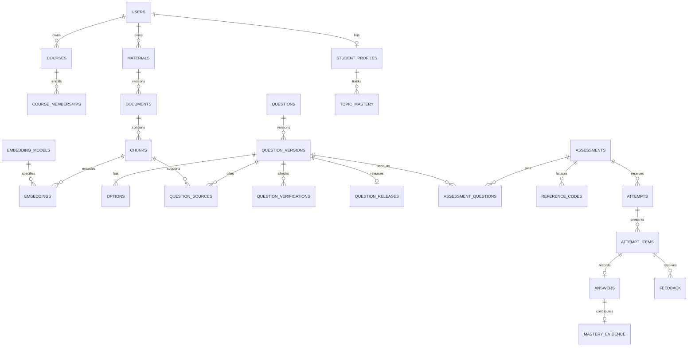

# Database design and operating guide

The original Phase 2 design below is a historical foundation; later module guides supersede its planned-service descriptions and installation observations. Default migration commands now apply **all 12 migrations**, through evaluation (012). Native setup must apply all 15 runtime-grant files. The retained project cluster has these migrations/grants on **native PostgreSQL 18.4 + pgvector 0.8.7**, at 127.0.0.1:55432. Native application startup, independent transactions, abrupt database restart and separate database/PDF restore passed with synthetic test data. See the [current local deployment guide](local-deployment.md) and [Phase 22 completion evidence](phase-22-completion.md). No default website account was created.

## Migration layout

| File | Purpose |
|---|---|
| `database/migrations/001_core.sql` | Relational tables, constraints, lifecycle triggers, indexes and derived scores |
| `database/migrations/002_vectors.sql` | Local pgvector extension and versioned 384-dimensional embeddings |
| `database/migrate.py` | Python standard-library runner; applies SQL using the installed psql client |
| `database/tests/schema.test.mjs` | Executable SQL workflow and failure tests on embedded PostgreSQL |
| `database/tests/test_migrate.py` | Runner input, checksum and local-connection tests |
| `database/tests/package-lock.json` | Pinned, test-only npm dependencies and integrity hashes |

These are forward-only migrations. Never edit a migration after applying it to a retained database. Add the next numbered file for subsequent changes. Corrections made during this phase were tested only on disposable databases; no retained native application database has been migrated.

The runner takes one transaction-level advisory lock, validates checksums/history, executes unapplied migrations in order and records their checksums in `mcq_meta.schema_migrations`. All selected migrations commit together. A missing pgvector installation rolls back the entire attempt, including the core schema. An explicitly requested `--target 1` can prepare just the relational schema, but that is **not RAG readiness**. Replaying matching migrations is a no-op. Changed/unknown/newer/gapped history is rejected. The runner never offers a destructive downgrade; use a tested backup and restore process before later production migrations.

Checksums normalize CRLF/LF differences. No application `.env` is read by the runner. No credentials are stored in migrations. `plan` lists files and checksums without connecting; it does not claim to know server state. `render` emits the exact transaction used by both embedded tests and native `apply`.

## Data dictionary

Every `id` below is UUID unless stated otherwise. Required fields have `NOT NULL` in the SQL. Foreign keys default to restrictive deletion; private history is not silently cascaded away. All event times use `timestamptz`; clients should display them in the user's timezone. Backend connections will use UTC.

| Table | Main fields / purpose | Relationships and invariants |
|---|---|---|
| users | email, display_name, password_hash, active | Normalized unique email; password hash only; actual hashing/login comes in Phase 4 |
| user_roles | user_id, role | Composite primary key; teacher and/or student |
| courses | owner_id, title | Teacher-owned classroom scope; teacher role checked at publication |
| course_memberships | course_id, student_id, active | Composite primary key; active membership needed to start classroom attempt |
| topics | owner_id, optional course_id, name | Course must share owner; unique name within owner/course |
| materials | owner_id, title, archived | Logical uploaded material; archive instead of destructive removal |
| documents | material_id, owner_id, version, storage_key, sha256, size, pages | Immutable material version; safe opaque PDF filename; unique material/version |
| chunks | document_id, owner_id, ordinal, pages, text, hash, token_count, splitter_version | Immutable extraction evidence; document owner must match |
| jobs | owner_id, kind, state, idempotency_key, lease, heartbeat | Persistent work queue records; claim/lease/recovery logic comes later |
| generation_runs | job_id, owner_id, generator_model, digest, prompt_version, settings | Immutable model/provenance record; no fabricated run inserted by migrations |
| questions | owner_id, archived | Logical question identity; no mutable answer content here |
| question_versions | question_id, version, owner_id, topic_id, optional generation_run_id, stem, explanation, correct_option, difficulty, cognitive_level, type | Immutable; unique logical version; all linked ownership must match |
| options | version_id, ordinal, content | Four distinct nonblank options; ordinals 0–3; stable composite option identity |
| question_sources | version_id, chunk_id, owner_id, evidence_quote | Same-owner evidence; append-only; additions stop once verification begins |
| question_verifications | version_id, model/digest, prompt/policy versions, verdict, seven scores, blind option, validation flags, math result, issues | Immutable; unknown scores may be null on failure but cannot satisfy PASS |
| question_releases | version_id, verification_id, reviewed_by, state, reason | Explicit matching successful verification; approved or quarantined; owner review needed for classroom publication |
| assessments | owner_id, optional course_id, kind, mode, state, time/attempt limits, randomization, release policy | Classroom = fixed with course; practice = private, fixed/adaptive; published settings frozen |
| assessment_questions | assessment_id, owner_id, position, version_id, points | Pins immutable versions; editable only in draft; no duplicate question version |
| reference_codes | assessment_id, code_digest, expires_at, revoked_at | Unique digest; only published classroom assessments; locator, not authentication |
| attempts | assessment_id, owner_id, student_id, attempt_number, idempotency_key, state, times | Unique attempt number and student request key; eligibility/max-attempt gate; submitted records frozen |
| attempt_items | attempt_id, assessment_id, owner_id, position, version_id, points, option_order | Immutable displayed sequence; fixed versions/points must match published snapshot; option order is a permutation |
| answers | attempt_id, version_id, selected_option, response_ms, is_correct, awarded_points | One answer per presented item; null selection means skip; scores match stored key and maximum points |
| feedback | attempt_id, version_id, student_id, category, comment, state | Student must own attempt and have seen question; one report per category per attempt/item |
| student_profiles | user_id, preferred_difficulty | One profile per student user; role enrollment enforced by future service |
| topic_mastery | student_id, topic_id, mastery, observations, current_difficulty, algorithm_version | Mastery 0–1; one aggregate per student/topic; algorithm not implemented here |
| mastery_evidence | student_id, topic_id, attempt_id, version_id, algorithm_version | Only submitted/scored evidence; duplicate application rejected; topic must match question |
| audit_events | bigint identity, actor_id, event_type, entity_type/id, details, timestamp | Append-only event store; automatic event emission is future backend work |
| embedding_models | model_name, revision, dimension, normalization | Immutable revision registry; 384 dimensions and L2 normalization in this baseline |
| embeddings | chunk_id, owner_id, model_id, dimension, vector, timestamp | One immutable embedding per chunk/model; ownership matches; vector is nonzero/unit length |

`attempt_scores` is a view, not a second score table. It derives possible points, awarded points and scored item counts from stored items/answers. A partial in-progress score is not a released student result. The future API must respect assessment release policy. Dashboards/analytics will use authorized aggregates rather than duplicate raw score storage.

## Relationships



## Transaction contracts for the later backend

1. **Save a candidate:** insert question version and exactly four options in one transaction. The deferred constraint rejects a partial version at commit. Add source citations before first verification. An edit always creates a new version and has no release record until checked again.
2. **Verify/release:** persist model metadata, blind solve, flags and criterion signals. PASS requires complete signals, schema/source/duplicate passes, supported or not-applicable math and no review requirement. Release additionally requires at least one citation and a blind answer matching the key. Numerical questions require a math PASS. This enforces recorded evidence structure; the database cannot establish that an LLM's factual judgment is correct. Threshold calibration and verifier logic remain later work.
3. **Publish:** draft assessment gets reviewed, approved version IDs and points. Transition to published validates eligibility and freezes content/settings. A classroom owner must be a teacher. Only published classroom tests receive codes. Adding new content requires a new draft assessment.
4. **Start:** lock assessment, check membership/limits, insert attempt and presented fixed items atomically. Service must validate code expiry/revocation before enrollment/join; possession of a digest/code is never proof of identity. Fixed items remain unchanged during a test; adaptive item selection is a separate mode.
5. **Score/submit:** save every answer, using null selected option for skipped items; assign zero or full item points according to the stored key; then mark submitted in the same transaction. Submission rejects missing/unscored items. After submission, answers and attempt identity cannot change. Feedback remains possible.
6. **Apply mastery:** lock the `(student_id, topic_id)` aggregate, insert unique evidence and update the aggregate in one transaction. A duplicate evidence insert must roll back the whole update. This prevents double application only when the future service follows this contract. No mastery algorithm is claimed implemented.
7. **Quarantine:** change a release state; preserve past scores/versions. New fixed attempts containing that item are paused, and new item selection requires approval. Items already presented retain their historical record. A replacement question is a new verified version in a new assessment.

Record provenance (model name **and digest**, prompt version, configuration and policy version) at run time. Placeholder model strings in tests are fixtures, not downloaded or tested models. Feedback is stored per category; aggregation, re-verification scheduling and moderation are not yet services.

## Vector search and permissions

Exact cosine search is sufficient for the initial small local corpus; no HNSW index is imposed on an 8 GB laptop. A B-tree index narrows owner/model rows. The 384-dimensional migration supports the planned MiniLM family; do not mix model revisions or dimensions. Switching dimensions requires a new migration/embedding corpus. Existing embeddings are not overwritten.

The later repository must filter by the authenticated owner, the authorized material/document set, and the exact model revision **before** ranking/limiting. Example query, with bound parameters:

```sql
SELECT c.id, c.content, c.document_id, c.page_start, c.page_end,
       e.embedding <=> $1::public.vector AS cosine_distance
FROM mcq.embeddings e
JOIN mcq.chunks c ON c.id = e.chunk_id AND c.owner_id = e.owner_id
JOIN mcq.documents d ON d.id = c.document_id
JOIN mcq.materials m ON m.id = d.material_id
WHERE e.owner_id = $2
  AND e.model_id = $3
  AND c.document_id = ANY($4::uuid[])
  AND NOT m.archived
ORDER BY e.embedding <=> $1::public.vector
LIMIT $5;
```

The owner and allowed document IDs must come from authorization, not unchecked browser input. For a student answering a teacher assessment, the API controls which excerpts/explanations are released; it does not give the student a direct database connection or unrestricted teacher-corpus search.

**Security boundary:** composite foreign keys enforce relationship integrity, not row-level read authorization. This phase revokes PUBLIC access but does not provision the runtime role or implement row-level security. The future API must authorize every read/write, protect keys, filter retrieval and apply the result-release policy. A database owner can bypass many integrity controls; never run the app with that account. Connection hardening, least-privilege grants, password hashing, JWT checks and adversarial API tests belong to Phases 3/4/21. Do not expose this schema directly to a browser.

## Native setup and use

Current observations: PostgreSQL 18.4 binaries exist at `C:\Program Files\PostgreSQL\18\bin`; no response was received on port 5432 in Phase 1; pgvector files were not present. The attempted isolated native `initdb` in Phase 2 failed under the Codex Windows sandbox's restricted-token rules. No native application database or PostgreSQL service was modified. Embedded tests do not resolve this setup requirement.

Once a native server is available:

1. Install pgvector compatible with that PostgreSQL build. The [official pgvector Windows instructions](https://github.com/pgvector/pgvector#windows) describe the supported build prerequisites. This phase does not install compiler tools or write into Program Files.
2. Create a dedicated local database and migration-owner login using PostgreSQL administration tools. Keep this separate from future `adaptive_mcq_app`. Use a private password and a properly protected PostgreSQL password file, or a short-lived process environment setting; do not commit credentials. No default password is provided.
3. From the project root, preview and apply with your available Python command:

```powershell
python database/migrate.py plan
python database/migrate.py apply --psql 'C:\Program Files\PostgreSQL\18\bin\psql.exe' --host 127.0.0.1 --port 5432 --database adaptive_mcq --user adaptive_mcq_migrator
```

The `apply` command requires an explicitly named database/user. It does not create accounts, prompt for a password, start servers, install extensions on disk or download anything. `CREATE EXTENSION` enables an already installed extension and may need administrator-granted database privileges. Authentication failures stop safely. Localhost-only connection arguments prevent accidental cloud use; inherited connection overrides are cleared.

4. Inspect `mcq_meta.schema_migrations`, `pg_extension`, and schema objects, then repeat the native integration suite before declaring deployment ready. Extension availability/version and native role permissions must be tested on the actual installation.
5. Back up before subsequent retained-database migrations and rehearse restore to a disposable database. No downgrade or cleanup command deletes user data in this phase.

## Reproduce the Phase 2 checks

Use Python 3.12+ and Node.js 22.x or another compatible maintained version. Runtime components are **FREE / OPEN SOURCE**. Test-only PGlite 0.5.8 and its pgvector package 0.0.9 are **FREE / OPEN SOURCE**; their versions are pinned in the test folder. npm is not part of the future database server.

```powershell
python -m unittest discover -s database/tests -p test_migrate.py
npm ci --prefix database/tests --ignore-scripts --no-audit --no-fund
npm test --prefix database/tests
```

If `python` is not on PATH, set `TEST_PYTHON` to an installed interpreter's absolute path for the npm test. Initial package download requires internet; subsequent tests with dependencies installed run locally. Test databases are in memory and disappear when closed. No `.env` or real user data is loaded. The fixture emails use `example.invalid` and cannot log in to any application.

The SQL tests cover both migrations, replay/checksum behavior, all-or-nothing failure with missing vectors, ownership links, immutable content, release/publication gates, eligibility/attempt limits, score/key consistency, feedback identity, bounded mastery, duplicate evidence and vector constraints/search. The runner tests cover platform line endings, invalid history numbering, target bounds and unsafe connection overrides. Multi-connection races, native grants, backup/restore, native pgvector installation and full backend integration remain pending.

## Design limits deliberately left visible

- Schema gates validate stored evidence; they do not make models factually correct or replace teacher review.
- Text-PDF extraction validity, page bounds against the actual file, quote matching, language detection and malicious file handling belong to ingestion/validation services.
- A code is a hashed locator. Secure generation, collision retry, rate limits, expiry/revocation enforcement and enrollment behavior are later endpoint logic.
- Topic-only generation still needs an approved local source corpus to satisfy grounding. Unsupported unsourced output must not be automatically released.
- Cognitive-level labels do not establish demonstrated diversity or a learning benefit. No experimental values are produced by database tests.
- Per-topic aggregate updates, attempt timeouts, job recovery and actual single-worker execution require later transactional services. Storage fields alone are not those features.
- Migrations are not an installed/running application. Native deployment and model hardware validation remain pending.

Technical references: [PostgreSQL initdb](https://www.postgresql.org/docs/18/app-initdb.html), [PGlite usage](https://pglite.dev/docs/), [PGlite pgvector extension](https://pglite.dev/extensions/), [pgvector](https://github.com/pgvector/pgvector).

## Phase 14 update

Migration 007 adds assessment revisions, immutable operation history, participant permissions, admissions and code-guess counters. Apply `database/assessment_runtime_grants.sql` after previous module grants. Publication/code creation and audit are atomic, codes are stored only as digests, and new managed attempt inserts require a current authorized admission. Legacy records and scores are preserved. [Assessment guide](assessments.md) supersedes the earlier planned-code endpoint notes above; native deployment and concurrent-transaction verification remain pending.


## Phases 15 and 16 update

Migrations 008 and 009 add managed attempt sessions, immutable retry commands, categorical automatic private releases, narrowly scoped attempt/scoring functions and derived learning evidence. Apply all migrations and both `database/attempt_runtime_grants.sql` and `database/adaptive_runtime_grants.sql` after previous module grants. Existing historical scores are preserved. The runtime has no direct answer, score or mastery writes. See [attempts and adaptive learning](attempts-and-adaptive.md) for timer, evidence, release and native-concurrency limits.


## Phase 17 update

Migration 010 adds version cases, ratings, append-only review/command history and a permanent confirmed-defect release guard. Apply `database/feedback_runtime_grants.sql` after existing module grants. Existing reports and scores are preserved; runtime writes remain function-scoped. See [feedback and quarantine](feedback.md).

## Phase 18 update

Migration 011 adds `mcq.analytics_data`, a scoped read-only function over attempt sessions, immutable items, answers, release states and feedback. Apply `database/analytics_runtime_grants.sql` after previous grants. No analytics cache/table or score rewrite is introduced. See [definitions and release rules](analytics.md).


## Phase 19 update

Migration 012 adds immutable evaluation-only storage and scoped evaluation/export functions. Apply `database/evaluation_runtime_grants.sql` after existing grants. Synthetic runs never insert questions or change releases/scores. See [evaluation setup](evaluation.md).
