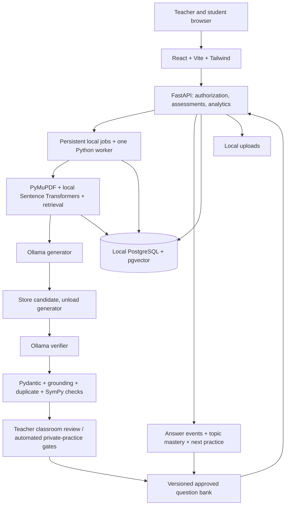

# Project Master Blueprint

> **Current handover — 15 October 2026:** the 24-stage engineering roadmap is complete with explicit deferrals. This document preserves the original 5 October design, including plans later narrowed or superseded. Use the [implemented status](adaptive-mcq/docs/project-progress.md), [limitations](adaptive-mcq/docs/limitations.md), [final deck](Adaptive_MCQ_Final_Review_Phase24_Final.pptx) and [evidence register](Final_Review_Evidence_Register.md) for current claims. Real generator/verifier inference and learner results remain unvalidated.

**ADAPTIVE MCQ GENERATION USING DUAL LLMs WITH STUDENT FEEDBACK**  
B.Tech, Computer Science and Engineering (Artificial Intelligence and Machine Learning)  
Sri Venkateswara College of Engineering (Autonomous)  
Academic Year 2026–2027  
Design review edition, 5 October 2026

**Historical status on 5 October 2026:** Proposed design and planned implementation. No source code, runnable application, implementation screenshots, experimental dataset or measured project results were supplied. None of the software features below are claimed as implemented. No application code has been created or modified as part of this review package.

The 22-slide presentation is the first review deliverable. This blueprint supplies the engineering detail behind it. Implementation remains gated on your approval and explicit **START PHASE 1** instruction.

## Evidence and decisions

| Source | What it establishes | Treatment |
|---|---|---|
| Attached IEEE Access MCQGen paper, 2024 | Existing method, evaluation and limitations | Primary research source, cited by printed page and section |
| Abstract image | Title, team, guide, intended dual-LLM feedback project | Team metadata retained. Benefit statements treated as aims |
| Pasted project requirements | Teacher/student journeys, features and requested blueprint | Requirements input, not evidence of completion |
| Technology-stack image | Original frontend, backend, data and AI layers | Preserved except superseded hosted AI and deployment |
| project_plan.png | Eight-layer architecture and user roles | Redrawn in the PPT using local services |
| Latest ₹0 requirement and hardware reply | Mandatory local free core, sequential execution | Governs all stack and model decisions |

The abstract mentions a “2025 system” without supplying its citation or paper. It cannot support a literature claim or priority claim. The earlier diagrams specify Gemini 3.8 Flash, Gemini 3.7 Flash and cloud hosting. Official Google documentation lists those Gemini models as API models; no local Ollama weights were established. They are excluded from this local-only design. Gemma is a separate model family and must never be renamed Gemini. [Google Gemini models](https://ai.google.dev/gemini-api/docs/models), [Gemma overview](https://ai.google.dev/gemma/docs).

### Hardware-validated model selection

**This is the model-selection process label requested by the student. Status: pending actual laptop benchmark, not yet hardware validated.**

| Supplied hardware | Design consequence |
|---|---|
| Dell Inspiron 14 3000, Intel Core i5-1035G1 @ 1.00 GHz | CPU-first inference. Actual sustained speed is unmeasured |
| 8 GB DDR4 | One inference worker and one resident LLM at a time |
| Intel UHD, no dedicated GPU or VRAM | Do not depend on GPU acceleration |
| Shared GPU memory up to 3.9 GB | Shares the same RAM; does not add another 3.9 GB |
| Windows, version unspecified | Confirm supported OS version before installing dependencies |
| Free storage unknown | Continue design now. Check space before downloads |

| Role | Initial benchmark candidate | Classification | What remains unknown |
|---|---|---|---|
| Generator | `qwen2.5:1.5b-instruct-q4_K_M` | FREE / OPEN SOURCE, Apache 2.0 checkpoint | MCQ quality, memory, latency |
| Verifier | `smollm2:1.7b-instruct-q4_K_M` | FREE / OPEN SOURCE, Apache 2.0 checkpoint | False acceptance and rejection, JSON reliability |
| Very small feasibility fallback | Qwen2.5 0.5B instruction checkpoint, exact tag checked at installation | FREE / OPEN SOURCE candidate, license/tag rechecked | May fail quality criteria; use for smoke tests, not an assumed adequate verifier |

Official Ollama pages list the selected quantized generator download at **986 MB** and verifier at **1.1 GB**. These are model-file sizes, not full RAM requirements. Runtime also needs context/KV cache, buffers, Python, embeddings, PostgreSQL, browser and Windows. These small candidates are a conservative starting point, not a guarantee that they are adequate for college-level question verification. [Qwen tag](https://ollama.com/library/qwen2.5:1.5b-instruct-q4_K_M), [SmolLM2 tag](https://ollama.com/library/smollm2:1.7b-instruct-q4_K_M).

Plan a 2,048-token inference context initially, one MCQ per generation request and at most three short retrieved chunks. Reserve output tokens explicitly. Generate a small batch, unload the generator, then load the verifier. Unload the embedding model after ingestion if memory requires it. These are starting settings to test, not measured optimum values. Avoid Docker and multiple development servers beyond those required on this laptop. Use a built frontend for the final demonstration if it reduces overhead.

Before selection is approved, record Windows idle memory, peak total memory with the full stack running, paging, model load time, generation/verification latency and a blinded quality sample. Reject any configuration that exhausts memory, causes sustained paging or fails the agreed quality rubric. If two different small models cannot produce useful quality, narrow the task to source-based conceptual questions and strengthen manual review. Do not replace a failed quality gate with a paid API. Same-model two-pass verification can be studied as an explicitly labelled fallback, but it is not evidence of independent-model verification. Free storage is an installation gate, not a reason to delay this blueprint.

## 1. Project title

**ADAPTIVE MCQ GENERATION USING DUAL LLMs WITH STUDENT FEEDBACK**

Full subtitle: An AI-Powered Adaptive Assessment Platform Using RAG, Dual-LLM Verification and Personalized Learning.

| Roll number | Team member |
|---|---|
| 23BFA33318 | V. NaveenKumar |
| 23BFA33310 | V. Jashwanth |
| 23BFA33328 | G. Sai Koushik |
| 23BFA33295 | P. Theja Bhuvan Reddy |

Project Team: 11. Guide: **Dr. D. Kavitha**, Associate Professor, Dept. of CSE (AI & ML). These details are transcribed from the supplied abstract and names in the request.

## 2. Problem statement

Teachers need relevant MCQs with plausible distractors and appropriate difficulty. Manual authoring is time-consuming. LLM output can be fluent but unsupported, ambiguous or mathematically unanswerable. Students need practice that responds to demonstrated understanding and lets them report question defects. The engineering problem is to combine generation, evidence checks, assessment control and learner feedback on an ordinary laptop without paid services.

## 3. Existing system

MCQGen is a 2024 research framework, not an implementation supplied with this project. It combines GPT-4, retrieval and prompt engineering for personalized MCQ generation. It incorporates instructor-designed and student-created questions, instructor involvement, student performance and feedback. It is inaccurate to call it wholly static, unverified, or lacking student feedback.

## 4. The 2024 paper’s approach

Citation: C. N. Hang, C. W. Tan and P.-D. Yu, “MCQGen: A Large Language Model-Driven MCQ Generator for Personalized Learning,” **IEEE Access**, vol. 12, pp. 102261–102273, 2024. DOI: [10.1109/ACCESS.2024.3420709](https://doi.org/10.1109/ACCESS.2024.3420709).

The knowledge base contains 605 MCQs, comprising 530 instructor-created and 75 student-created items (Section III-B, p. 102266). RAG brings relevant examples and knowledge into generation. Self-refine develops the stem and key; CoT prompting supports distractor generation and selection (Section III-C, pp. 102266–102268). Instructors adapt later questions using student responses, and manually check answerability in the classroom example (Section V, p. 102270).

## 5. The paper’s limitations

| Supported statement | Evidence |
|---|---|
| Evaluation exists but extensive quantitative evidence is limited | Section VII, pp. 102271–102272 |
| Question-quality study is small | 60 MCQs, 20 each math/concept/code; three lecturers, Section IV-A, p. 102268 |
| Learning/feedback example is very small | Two students over 12 lectures, Section V, pp. 102269–102270 |
| Generation-model comparison is absent | GPT-4 used as generator, Section VII |
| Other LLMs do participate in evaluation | GPT-3.5, LLaMA-2, PaLM 2 evaluate outputs, Section IV-A |
| Domain and language scope are narrow | Computer Science and English, Section VII |
| Diversity and complexity need improvement | Sections IV-B and VI, pp. 102269 and 102271 |
| Correct mathematical option can be missing | Sections IV-B and VI |

Stronger production verification and richer mastery profiles are proposed responses to the evidence. Do not attribute the specific algorithms below to the paper. Its figures contain rating scores; “no numerical results” would be false. No exact chart averages are copied into our project’s results.

## 6. Proposed system

A local web platform accepts study materials, retrieves authorized evidence, generates MCQs, checks them with a second local model and deterministic validators, and stores versioned questions. Teachers publish reviewed assessments. Students join through access codes or create private practice. Topic-level evidence controls subsequent practice, while structured feedback triggers quality review.

The minimum credible demonstration is one material-to-assessment journey with working verification, failure handling, submission, scoring and feedback. A polished interface without those behaviors is not completion.

## 7. Improvements over the paper

Separate production generator/verifier roles; deterministic checks for supported math; auditable versioned review; private practice plus classroom codes; explicit mastery state; feedback triage; configurable model experiments; local cost-free execution. These are proposed engineering extensions. RAG, feedback, teacher involvement and adaptation are inherited ideas. Greater correctness, lower effort and learning benefit are hypotheses, not facts.

## 8. User roles

**Teacher:** owns course material and assessments, manages question versions, reviews candidates, publishes approved snapshots, manages codes, sees permitted class analytics. **Student:** owns private uploads, joins permitted assessments, submits answers, sees permitted results, reports question issues and practices privately. Public role selection cannot grant access to someone else’s course. The local demonstrator may use teacher accounts seeded by a setup process rather than unrestricted teacher privilege escalation.

## 9. Complete feature list and scope

| Planned core | Planned extension after core acceptance | Future research |
|---|---|---|
| Authentication and separate dashboards | Expanded question-bank filters and exports | Telugu/Hindi and broader domains |
| Text PDF/text ingestion and local RAG | More numerical templates | Multimodal and image-only PDF OCR |
| Configurable local generator + verifier | Code-reading/output-prediction items with safe review | Sandboxed code execution |
| Schema, grounding, duplicate and math checks | Cognitive-level coverage analysis | Formal mathematical proof checks |
| Teacher review and versioned publishing | Optional controlled LAN classroom demonstration | Validated advanced learner modelling |
| Reference-code access and scoring | Richer topic/concept analytics | Larger research-scale user study |
| Student self-practice and feedback | Model-pair comparison harness | Multiple-correct and free-response formats |
| Mastery profile and adaptive practice | Configurable diversity quotas | Automatic model training only if separately designed |

Single-correct MCQs with four distinct options are the initial contract. Five difficulty labels are Beginner, Easy, Medium, Hard and Expert. Bloom levels are metadata distinct from difficulty. “Create” should not be claimed as reliably assessed by selecting an option; use appropriate objectives and leave open-ended creation tasks to future formats.

## 10. Functional requirements

| ID | Requirement | Acceptance evidence planned |
|---|---|---|
| FR01 | Secure login and role authorization | Cross-role and cross-owner access tests |
| FR02 | Upload and process permitted material | Extracted page/chunk provenance and failure status |
| FR03 | Generate configurable MCQ candidates | Valid structured fields, configuration recorded |
| FR04 | Separate verifier and validation gates | Persisted verdicts and reasons, no silent bypass |
| FR05 | Review, edit, reject, regenerate, approve | Version history and invalidated approvals after edits |
| FR06 | Publish immutable assessment snapshot | Only approved versions, ordered membership |
| FR07 | Issue, revoke, expire and validate codes | Authenticated eligibility and expiry enforcement |
| FR08 | Save, resume and submit attempts | Server-side scoring, idempotent submit |
| FR09 | Private practice without a code | Owner-only material and practice visibility |
| FR10 | Update mastery and select next practice | Reproducible explanation and evidence count |
| FR11 | Report and review defects | Version-linked feedback, quarantine path |
| FR12 | Analytics and evaluation exports | Aggregates trace to authoritative events |

## 11. Non-functional requirements

No required paid or hosted runtime dependency. The prepared system must run offline after downloads. One laptop and one inference job at a time are the supported initial capacity, not an untested multi-class deployment. UI must show queue/progress/cancellation and actionable failures. Record p50/p95 latency before setting performance promises. Use keyboard-accessible controls, readable contrast and responsive layouts. Preserve attempt consistency across crashes. Back up local files and PostgreSQL together with version references. Pin dependency and model versions for repeatable evaluation. No measured latency, concurrency or accuracy targets are claimed.

## 12. Complete system architecture



A persistent PostgreSQL job table avoids adding a memory-heavy queue service. The worker claims a job transactionally, records progress and can recover interrupted jobs. Initially it performs ingestion and inference sequentially. Separating services in code does not require multiple machines or simultaneous models.

## 13. Module architecture

| Module | Responsibility | Why separate it |
|---|---|---|
| Identity/access | Passwords, JWT, ownership, memberships | Central enforceable permissions |
| Materials | Files, versions, extraction, chunks | Provenance and safe reprocessing |
| Retrieval | Embedding version and authorized search | Reproducible context selection |
| Generation | Prompt contract and local model calls | Swappable models without UI changes |
| Verification | Blind solve, critique, structured verdicts | Independent role and auditable reasons |
| Validation | Schema, math, duplicates, sources | Deterministic enforcement outside prompts |
| Review/bank | Question versions and approval state | Prevent stale approval after edits |
| Assessments | Codes, snapshots, timing and attempts | Consistent classroom behavior |
| Adaptation | Topic evidence, policy and selection | Testable rules without model inference |
| Feedback/analytics | Reports, aggregation and exports | Separate quality issues from student ability |

## 14. RAG architecture

Validate file type/size, assign an opaque filename and checksum, save a document version, extract page-aware text, remove repeated headers cautiously and retain mathematical/code structure. Split using the embedding tokenizer. For the initial all-MiniLM-L6-v2 candidate, use its documented 256-wordpiece limit: start near 160–200 tokens with modest overlap and count actual encoded length including special tokens. Its vectors have 384 dimensions. Store model revision, chunk offsets, page range and content hash. [Model card](https://huggingface.co/sentence-transformers/all-MiniLM-L6-v2).

Use local embeddings, not an embedding API. Query vectors and stored vectors must use the same model and preprocessing. Begin with exact pgvector cosine search for a small corpus. Add HNSW only after measuring scale; approximate search with ownership filters needs recall checks. Retrieve only documents the user may access. [pgvector documentation](https://github.com/pgvector/pgvector).

Select a small set of diverse source chunks within the inference token budget. Save actual retrieved text/hash and references with the generation run. If evidence is insufficient, return “More source material required.” Topic-only mode selects from existing authorized materials; with no corpus it requests material. It must not claim RAG grounding for unsupported free-form model knowledge. Scanned PDFs have an explicit unsupported/OCR-needed status in the initial scope.

## 15. Dual-LLM architecture

The configuration includes `GENERATOR_MODEL`, `VERIFIER_MODEL`, model digests, context/output limits and prompt versions. Values remain replaceable without application code changes. Candidate values are listed in the hardware section. Ollama calls go to the local service only. Set `OLLAMA_NO_CLOUD=1`, restrict the endpoint to loopback and reject cloud tags or external provider configuration. [Ollama FAQ](https://docs.ollama.com/faq).

1. Generator receives evidence, type, difficulty, cognitive objective and a strict output schema.
2. Schema gate rejects malformed candidates before expensive review.
3. Persist candidate; unload generator; load verifier.
4. Blind verifier sees stem/options/context without generator key or explanation, chooses zero/one/multiple supported options and cites evidence.
5. Comparison pass checks the proposed key/explanation against that verdict and evidence.
6. Deterministic validators execute; aggregate verdict is PASS, REGENERATE, REJECT or REVIEW_REQUIRED internally. Public UI explains each state.
7. Proposed limit: at most two regeneration attempts per candidate, then reject/hold. This operational limit is configurable and evaluated.

The verifier emits issues, supported answer, source links and criterion ratings. Its confidence score is not a calibrated probability. Distinct checkpoints reduce role coupling but cannot guarantee independent errors. Record false passes and false rejections against blinded human labels. Both LLMs are frozen during normal operation.

## 16. MCQ verification pipeline

Release requires a valid schema, four non-empty distinct options, exactly one supported correct option, source support, acceptable semantic review, duplicate clearance and applicable math checks. Model output is data, never executable code. Source documents and student comments are untrusted prompt content and cannot modify system instructions.

Question state: Draft → Generated → Validation pending → Verified candidate → Teacher review → Approved → Published snapshot. A failure creates Regenerate, Rejected or Review required. Editing creates a new version and clears verification/approval. Feedback may mark an existing version Quarantined. Published historical versions remain available for audit, with a visible defect/correction record.

For student private practice, automated gates can release clearly labelled “automatically checked” items. They are not represented as teacher approved. Unsupported math, unresolved ambiguity and serious verifier disagreement never auto-release.

## 17. Mathematical validation strategy

Start with explicitly supported classes: arithmetic, percentages, simple algebra and equations with specified domains. Parse a restricted structured mathematical representation. Do not run arbitrary LLM Python or unsafe expression strings. Use exact SymPy rational/symbolic calculations when possible and bounded numerical calculations with explicit tolerances when justified.

For every supported item, compute the answer independently, verify assumptions and units, compare against each option, require exactly one equivalent option, and confirm that it matches the stored key. Equivalent distractors such as 0.5 and 1/2 invalidate a single-correct item. Rounding must be specified in the stem; nearest-option guessing is not validation. Reject missing answers, multiple matches, division by zero and contradictory assumptions. Timeout, ambiguous parsing or unsupported content produces REVIEW_REQUIRED. General word-problem understanding and formal proofs are outside the deterministic guarantee. A teacher can review such items, but the record must not say deterministic validation passed.

## 18. Adaptive learning algorithm

**Candidate policy, to be evaluated.** Use only first eligible responses to valid question versions for ability evidence. Store all responses for analytics but avoid counting retries or repeated items as independent learning evidence. A skipped item is recorded separately. Final handling of skips is protocol-defined. Flagged items do not alter mastery once a defect is confirmed; recompute affected profiles from retained events.

For topic t, difficulty level d and eligible answer i, let yᵢ be 1 for correct and 0 for incorrect. Let ageᵢ count later eligible attempts in that topic and rᵢ = λ^ageᵢ, with 0 < λ ≤ 1. Start with a symmetric prior a = 1, b = 1 as a **design assumption**, not a fitted learner parameter:

**p(t,d) = (a + Σ rᵢ yᵢ) / (a + b + Σ rᵢ)**, summing answers at difficulty d.

For reporting a provisional topic index:

**M(t) = 100 × Σ[w(d) c(t,d) p(t,d)] / Σ[w(d) c(t,d)]**,

where w(d) are positive declared difficulty weights and c(t,d) is 1 only when that level has sufficient evidence, otherwise 0. If the denominator is zero, display “Insufficient evidence,” not 0% or 50% mastery. Show covered levels and answer counts with M(t). This weighted index is a performance indicator, not a psychometrically validated probability of knowledge, and is not comparable across students with different level coverage without calibration.

For next-question difficulty, use p(t,current level), evidence count and a recent-answer window. Promotion requires p ≥ upper threshold, enough unique items and stable recent performance. Demotion requires p ≤ lower threshold and adequate evidence. Require lower < upper (hysteresis); otherwise keep level. Move by at most one level. Begin at Medium unless a teacher/diagnostic chooses another level. λ, weights, minimum evidence, window size and thresholds are **To be evaluated** on a development set before being frozen for a held-out test.

Select an unseen approved item from a weak but sufficiently assessed topic, with topic coverage and question-type diversity constraints. If the bank has no eligible question, use the nearest allowed level or show a generation queue; do not expose unverified output. Cold-start profiles get a balanced diagnostic set. Response time is diagnostic, not an automatic penalty for slow reading. Feedback affects question trust and review, not direct ability rewards. Fixed graded assessments are unaffected by this practice policy. Compare this policy with no adaptation and the paper-like one-step response policy.

## 19. Student feedback architecture

Persist category, optional comment, user, attempt, question version, timestamp and review status. Categories: wrong answer, wrong explanation, ambiguity, poor wording, weak distractor, too easy, too difficult, duplicate, not from material, mathematical error, other; also a helpful rating.

Aggregate distinct reporters divided by exposures. Deduplicate repeat reports. Teacher confirmations have greater authority than raw complaint counts. Serious confirmed errors quarantine affected versions and trigger correction/re-grading review where appropriate. Thresholds for review priority are configurable and evaluated. Student feedback changes selection filters and teacher-reviewed prompt/rule versions; it does not retrain model weights. Preserve audit history and evaluate prompt changes before releasing them.

## 20. Teacher workflow

Login → choose/create course and topic → create assessment draft → upload/select material → set count, difficulty, question type and cognitive objective → generation job → validation report → review each item → approve/edit/regenerate/reject → preview → publish immutable approved set → issue reference code → share manually → view authorized class performance and reports. Teacher edits always re-enter checks. English is the initial language; other language choices remain disabled or marked future until validated.

## 21. Student workflow

**Classroom:** login → enter code → eligibility checks → begin attempt → answer/save → submit → backend score → teacher-controlled result release → topic analysis and subsequent practice recommendation.

**Private practice:** login → upload/select material → set generation criteria → wait for validated candidates → attempt → immediate explanations/source references → feedback → profile update → next approved practice item. No classroom reference code is required. Personal uploads remain private unless the owner explicitly shares them through a designed permission flow.

## 22. Reference-code workflow

Use cryptographically random codes, a database uniqueness constraint and collision retry. The example AI-ML-8F42K is not a security specification. Choose entropy and validation rate limits for the actual audience. Normalize input without losing entropy. Validate authenticated user, assessment publication, active/revoked status, expiry, allowed participants and remaining attempts. Code possession alone must not bypass authorization.

Publish and code creation are transactional. Store option/question permutations per attempt; grade stable option IDs, not displayed letters. Server time enforces deadlines. Submission uses an idempotency key or unique state transition. Revocation blocks new attempts according to the stated policy and does not erase existing evidence. Reference codes work in a single-machine demonstration by switching user accounts. Multi-device access needs a separately configured LAN setup.

## 23. Database architecture

| Entity group | Core entities and relationships |
|---|---|
| Identity | users, roles/user_roles, course_memberships; courses → subjects → topics |
| Source material | user 1:N materials; material 1:N documents (immutable versions); document 1:N document_chunks; chunks 1:N embeddings by embedding revision |
| Questions | question 1:N question_versions; version 1:N question_options; version M:N chunks through question_sources; version 1:N question_verifications |
| Publication | user 1:N assessments; assessment M:N question_versions via assessment_questions; assessment 1:N assessment_access_codes |
| Activity | student 1:N student_attempts; attempt 1:N student_answers; answer targets pinned question version and selected option ID |
| Personalization | user 1:1 student_profiles; profile 1:N topic_mastery; evidence references answer events |
| Quality | feedback/question_reports reference user, attempt, question version; generation_runs and job records retain model/prompt provenance |
| Audit | audit_logs record actor, action, object/version and timestamp; analytics derive from attempts, answers and reports |

Private practice uses an assessment/session row with private ownership and no access code. Avoid disconnected scoring systems for the two modes. Scores derive from answers and may be cached with a version marker, not silently duplicated into inconsistent tables.

Primary keys are stable opaque IDs. Foreign keys enforce ownership-linked objects and valid references. Add unique constraints for email normalization, (question, version), (version, option position), (attempt, assessment-question), access-code hash/value, and (student, topic, policy version) mastery. Validate exactly one key in the single-correct contract through transactional application logic and database constraints/triggers where appropriate. Prevent source-version deletion while referenced by an assessment; archive instead. Store timestamps in UTC.

Indexes: ownership/status on materials and assessments; document/chunk foreign keys; question topic/status/difficulty; assessment membership/order; attempts by student and assessment; feedback by version/category/status; generation jobs by status/created time. Begin with exact vector scans and benchmark HNSW when justified. Embedding model changes create a new embedding version/dimension path and re-index; never mix incompatible vectors.

## 24. REST API architecture

All paths below are **planned contracts**, not live endpoints. Prefix `/api/v1`. Return structured errors with code/message/request ID and validation details safe to reveal. Paginate lists. Enforce object ownership server-side.

| Area | Representative contracts | Permission / behavior |
|---|---|---|
| Authentication | POST /auth/register, /auth/login, /auth/refresh, /auth/logout; GET /me | Controlled roles, hashed passwords, revocable refresh session |
| Courses | GET/POST /courses; POST /courses/{id}/topics | Teacher-owned course scope |
| Material | POST /materials; GET /materials/{id}; POST /materials/{id}/process | Owner access, upload limits, 202 job response |
| Generation | POST /generation-jobs; GET /generation-jobs/{id}; POST /generation-jobs/{id}/cancel | Async queued work; owner and bounded inputs |
| Questions | GET /questions; POST /questions/{id}/versions; POST /question-versions/{id}/verify | Teacher or private owner, immutable versions |
| Review | POST /question-versions/{id}/approve, /reject, /regenerate | Teacher classroom authority; audited action |
| Assessment | POST /assessments; PATCH /assessments/{id}; POST /assessments/{id}/publish | Draft edit only, approved-version gate |
| Codes | POST /assessments/{id}/codes; POST /codes/{id}/revoke; POST /assessment-joins | Teacher administration, student eligibility |
| Attempts | POST /assessments/{id}/attempts; PUT /attempts/{id}/answers/{itemId}; POST /attempts/{id}/submit | Student owner, idempotent answer/submit behavior |
| Results | GET /attempts/{id}/results | Release-policy check, no key leakage before release |
| Practice | POST /practice-sessions; GET /practice-sessions/{id}/next | Approved items and reproducible adaptive policy |
| Feedback | POST /question-versions/{id}/feedback; GET /assessments/{id}/reports | Attempt-linked student report, authorized teacher view |
| Analytics | GET /me/mastery; GET /assessments/{id}/analytics | Personal or teacher-owned scope only |
| Evaluation | POST /evaluation-runs; GET /evaluation-runs/{id}/export | Local research/admin control, no public unrestricted inference |

Student question responses omit key and explanation until release. Use 401 for unauthenticated, 403/404 according to disclosure policy, 409 for state conflicts, 422 for invalid inputs and explicit retryable statuses for resource failures. Generation jobs return partial progress without representing incomplete sets as finished.

## 25. Frontend architecture

React routes: landing/login/register, teacher dashboard, course/topic management, material upload, generation configuration/progress, question review, question bank, assessment settings/preview, code management, analytics; student dashboard, code join, private generation, attempt, results, feedback, topic mastery, profile/settings. Shared components handle loading/empty/error states, accessible forms, source evidence, version/status labels and pagination. Role guards improve navigation but never replace backend authorization. No fake metrics or charts: show “No attempts yet” until real events exist. UI mockups in the PPT are explicitly conceptual.

## 26. Backend architecture

FastAPI routers accept Pydantic request contracts. Services enforce state transitions. Repositories handle parameterized persistence and transactions. AI adapters isolate Ollama. Separate ingestion, retrieval, generation, verification, mathematical validation and adaptive policy functions so each can be tested with fixtures. A local worker handles persistent jobs, timeouts, cancellation and crash recovery. Begin with one worker and no inference concurrency. HTTP requests remain responsive while generation queues. Store sanitized logs, model timings and failure reasons without logging passwords, JWTs or full private documents by default.

## 27. Security architecture

JWT is a token format, not encryption. Use a maintained free JWT library, explicit algorithm allowlist, expiry/issuer/audience checks, strong local secret and short access sessions. Hash passwords using a maintained Argon2-capable free library. Never log tokens. Prefer in-memory access tokens plus carefully configured HttpOnly refresh cookies; if cookie authentication is used, add CSRF defenses. Local HTTP development and later HTTPS/LAN settings must be explicit and distinct.

Validate upload signatures/types, size/page limits and path traversal; use opaque filenames outside public static content. Do not run embedded PDF scripts or generated code. Parameterize SQL. Render model output as text or sanitized Markdown; avoid unsafe HTML. Rate-limit login, code guesses and generation. Bind PostgreSQL/Ollama locally, restrict CORS to the local frontend, and keep secrets out of React. Enforce document ownership during retrieval, not after generation. Treat retrieved instructions as untrusted data. Provide deletion/archive policies and export/backups. A local deployment still needs these controls because role mixing and uploaded files remain attack surfaces.

## 28. Evaluation methodology

Use independently annotated, authorized study material and held-out questions/tasks. Human evaluators blind to generation condition score item validity with a written rubric. Use at least two independent ratings where feasible plus adjudication; actual reviewer count is Planned. Report inter-rater agreement and disagreement, not just mean scores. LLM judges are secondary evidence and must not be the sole quality authority for the system they help create.

Report both raw candidate quality and quality after filtering, retention yield, reject/regen counts and reviewer time. Otherwise a strict filter can appear accurate by retaining very few easy questions. Keep teacher edits separate: report automated pipeline performance before edits and classroom release quality after review. Use anonymized participant data and faculty-approved consent/recruitment procedures for any learner study.

## 29. Experimental design

| Condition | Changed component | Purpose |
|---|---|---|
| A | Same local generator, topic prompt only | Baseline generation |
| B | A + authorized retrieved context | Retrieval contribution |
| C | B + separate verifier | Verifier contribution |
| D | C + deterministic math checks | Math-validation contribution |
| E | Validated bank + adaptive practice | Learner-policy evaluation against fixed practice |

A–D use matched topics, document splits, counts, difficulty requests, output budgets and repeated generation seeds where supported. Baseline grounding is independently assessed against the same evaluation corpus even when it does not see that corpus. Freeze prompts/thresholds using a development split, then test on held-out documents. Keep model-pair experiments separate from pipeline ablations. Record model tag/digest, quantization, context, token budget, source revision, retrieved IDs, prompt version, hardware and warm/cold timing.

For a pilot, a balanced concept/math/code-reading set can follow the paper’s categories, but sample size, topic counts and reviewer availability must be finalized with the guide. No invented recruitment total is asserted. A small pilot tests feasibility, not generalizable learning benefit. For E, use random assignment or a counterbalanced crossover with matched content and a common pre/post test. Avoid reusing training/practice questions in the outcome test. Account for order and practice effects. If recruitment is infeasible, report only offline policy replay and usability evidence, not improved learning.

## 30. Metrics

| Metric | Planned operational definition |
|---|---|
| Factual correctness | Independently adjudicated factually correct items / rated items |
| Answerability | Items with exactly one defensible listed answer / rated single-correct items |
| Grounding | Items whose required claims are supported by cited material / source-mode rated items |
| Relevance | Anchored human score for requested topic/objective |
| Distractor quality | Plausible, distinct and incorrect distractor rubric; later option-selection evidence |
| Difficulty agreement | Agreement between requested/model labels and expert labels; later calibrated response evidence |
| Diversity | Unique type/topic coverage plus semantic near-duplicate analysis |
| Complexity | Expert cognitive-demand rubric, separate from difficulty |
| Duplicate rate | Confirmed near/exact duplicate items / generated items under declared comparison scope |
| Verifier false acceptance | Invalid gold-labelled candidates passed / invalid candidates |
| Verifier false rejection | Valid gold-labelled candidates rejected / valid candidates |
| Retention yield | Candidates passing all automated gates / generated candidates |
| Latency | End-to-end and per-stage p50/p95 seconds; report queue and cold-load time separately |
| Resource feasibility | Peak memory, paging incidents, model load failures, disk usage |
| Satisfaction | Stated survey items, scale, response count and missingness |
| Learning outcomes | Common-test change with group comparison and uncertainty, only if a proper study occurs |

Report denominators and confidence intervals. Bootstrap by source document or learner where observations are clustered. Distinguish per-question correctness from student response accuracy. A model’s self-rated confidence is not an evaluation result. Every current project-result field is **To be evaluated**.

## 31. Technology stack and cost

| Component | Selected use | Classification |
|---|---|---|
| UI | React, Vite, Tailwind CSS | FREE / OPEN SOURCE |
| API | Python, FastAPI, Pydantic | FREE / OPEN SOURCE |
| Storage | Local PostgreSQL + pgvector | FREE / OPEN SOURCE |
| PDF | PyMuPDF, AGPL open-source option | FREE / OPEN SOURCE; comply with the chosen license |
| Embeddings | Sentence Transformers + all-MiniLM-L6-v2 candidate | FREE / OPEN SOURCE; local checkpoint |
| LLM runtime | Ollama local-only | FREE / OPEN SOURCE |
| Models | Quantized Qwen2.5 1.5B + SmolLM2 1.7B candidates | FREE / OPEN SOURCE; Apache 2.0 tags cited above |
| Math | SymPy, Python standard math; NumPy if needed | FREE / OPEN SOURCE |
| RAG orchestration | Direct Python; LangChain only if justified | FREE / OPEN SOURCE |
| Auth | JWT library + password hashing + FastAPI utilities | FREE / OPEN SOURCE |
| ORM/migrations proposal | SQLAlchemy + Alembic, if adopted | FREE / OPEN SOURCE |
| Development | Git, Python, Node.js/npm, pgAdmin | FREE / OPEN SOURCE |
| Optional development conveniences | VS Code free distribution, GitHub Free, Postman Free or equivalent | FREE functionality only; not runtime dependencies |
| Primary deployment | Existing Windows laptop | No service subscription |

There are **no OPTIONAL PAID components** in the proposed core. Cloud deployment is **OPTIONAL FUTURE DEPLOYMENT**, not designed as a prerequisite. Docker Desktop is omitted from the initial laptop setup. PyMuPDF provides AGPL and commercial options; the plan selects the free AGPL route, with license notices/source obligations reviewed before distribution. [Official PyMuPDF repository](https://github.com/pymupdf/PyMuPDF).

Cost target **₹0 required software/API/hosting/database fees**, assuming existing hardware and downloads. Electricity, existing internet and hardware acquisition are not claimed to be free. A free hosted API still fails the local-only requirement.

## 32. Planned folder structure

This is documentation of future files, not an application created in this task.

```text
adaptive-mcq/
  frontend/src/
    app/ routes/ components/ features/ api/ styles/
  backend/
    app/
      api/v1/ core/ schemas/ models/ repositories/ services/
      ai/ rag/ validation/ adaptive/ workers/
    migrations/ tests/ uploads/
  evaluation/
    protocols/ rubrics/ fixtures/ runs/ reports/
  docs/
    architecture/ user-guide/ demonstration/ evidence/
  scripts/
    local-start/ backup/ restore/
  .env.example
  README.md
```

Uploads, local database backups, tokens and private evaluation data stay out of Git. Commit source, migrations, rubrics and safe synthetic test fixtures with clear labels.

## 33. Development roadmap

| Phase | Planned deliverable | Exit evidence |
|---|---|---|
| 1 | Requirements/architecture freeze + laptop feasibility plan | Approved scope, no unsupported model promise |
| 2 | Schema and migrations | Constraints, seed fixtures, migration round trip |
| 3 | FastAPI foundation | Health/config/error handling |
| 4 | Authentication/roles | Role and ownership tests |
| 5 | Frontend foundation | Accessible navigation and empty states |
| 6 | Teacher dashboard | Real material/assessment data integration |
| 7 | Student dashboard | Correct joins/private-practice access |
| 8 | PDF ingestion | Page/chunk provenance, failure handling |
| 9 | Local RAG | Authorized retrieval and evidence inspection |
| 10 | Generator integration | Structured generation, queued progress |
| 11 | Verifier integration | Blind verdict and comparison, sequential loads |
| 12 | Validation | Math fixtures, duplicates, hard release gates |
| 13 | Teacher review | Versioned edit/re-validation/approval |
| 14 | Reference codes | Publication, access/expiry/attempt enforcement |
| 15 | Assessment attempts | Server-side idempotent grading |
| 16 | Adaptive engine | Reproducible profiles and bounded policy |
| 17 | Feedback | Version reports, quarantine and review |
| 18 | Analytics | Consistent source-derived metrics |
| 19 | Evaluation harness | Matched conditions and exports |
| 20 | Integration testing | Full teacher/student flows and failures |
| 21 | Security hardening | Authorization, upload and token checks |
| 22 | Local deployment | Offline prepared demo and recovery |
| 23 | Documentation | Setup, user guide, limitations and demo script |
| 24 | Final evidence update | Replace Planned labels only with verified results |

No schedule dates or completion percentages are invented. Before each implementation phase: objective, architecture, affected files, database/API changes, dependencies and tests must be explained. Implement only that approved phase. Afterward show checks and actual evidence. The current task ends at review artifacts.

## 34. Testing strategy

Use deterministic fixtures for contracts and failure cases, never claim fixture outcomes as experiment results. Unit checks cover option uniqueness, symbolic equivalence, rounding, mastery updates and access predicates. Integration checks use an isolated local database for jobs, publishing, answer persistence and idempotent scoring. Contract tests mock malformed, timed-out and contradictory LLM responses. Real-model benchmark tests are separate and explicitly record nondeterminism.

End-to-end cases: teacher creates/publishes; student joins/submits; student privately generates; unauthorized material cannot be retrieved; revoked/expired code fails; edited question loses approval; two equivalent correct options fail; wrong key withheld; interrupted job recovers; submit retry creates one result; confirmed defective item does not corrupt mastery. Test a prepared offline demo with cloud disabled and external network unavailable. Record actual results before calling a phase complete.

## 35. Deployment architecture

Primary deployment is the existing local laptop, with prerequisites downloaded beforehand. Bind services to loopback. Planned startup order:

1. Start local PostgreSQL with pgvector enabled.
2. Start Ollama with cloud disabled and the benchmark-approved local model files.
3. Start FastAPI and its single local worker.
4. Start the frontend or serve a built local frontend.

Planned development addresses: frontend `http://localhost:5173`, backend `http://localhost:8000`, API docs `http://localhost:8000/docs`. These are intended addresses, not currently running services. Startup should check ports, migrations, storage, models and available resources and return clear errors. The code must not silently download a model or contact a paid provider on failure. A native Windows pgvector-compatible install, or a measured lightweight alternative local setup, must be validated before the deployment phase. Avoid assuming WSL/Docker overhead is negligible on 8 GB RAM.

For the demonstration, pre-index a small authorized corpus and prepare approved question-bank items, while retaining a short live generation path to demonstrate real AI behavior. Do not present pre-generated questions as live output. Backups include PostgreSQL, uploads, model/prompt identifiers and configuration without secrets. More devices require a separately planned authenticated LAN deployment; localhost addresses do not work from students’ other computers.

## 36. Project risks

| Risk | Planned response / limit |
|---|---|
| Small local models miss errors | Blinded validation, deterministic gates, teacher review, narrowed supported scope |
| Two models share mistakes | Measure verifier false acceptance; separate-model and same-model ablations |
| 8 GB memory pressure | Sequential loading, small context, one worker, release embeddings, measure paging |
| Slow CPU inference | Pre-generate, queue visibly, cache retrieval; no unmeasured latency promise |
| Missing/bad source text | Provenance checks and explicit unsupported document status |
| Wrong-source retrieval or leakage | Ownership filtering and held-out retrieval tests |
| Unsupported mathematics | REVIEW_REQUIRED; never claim universal validation |
| Feedback manipulation | Distinct legitimate reporters, exposure normalization and teacher adjudication |
| Small learner study | Limit conclusions; report uncertainty and recruitment limitations |
| License/model availability change | Pin and record exact packages, model digests and licenses at installation |
| Scope exceeds available time | Prioritize validated end-to-end core; label extensions and future work honestly |
| No implementation evidence yet | Keep all software functionality labelled Planned until demonstrated |

## 37. Research novelty

Defensible current statement: **We propose and plan to evaluate a local, resource-constrained integration of RAG, separate LLM generation and verification, deterministic checks, teacher review and topic-adaptive practice with structured feedback.**

Research hypotheses: a separate verifier lowers invalid retained questions; deterministic math checks reduce missing/wrong correct options in supported classes; explicit mastery state improves practice sequencing relative to fixed or one-step response policies. These require ablations and outcome evidence. Interface polish, reference codes and CRUD features are engineering contributions, not algorithmic novelty. RAG, dual roles and feedback are not individually claimed as inventions. A broader related-work search and the missing 2025 reference are needed before any “first” claim.

## 38. Expected outcomes

Planned deliverables are a runnable local platform, reproducible setup, traceable question bank, verified assessment workflow, private practice, topic profiles, feedback review, evaluation exports and a faculty demonstration. Expected reliability and educational benefits remain **To be evaluated**. No percentages, speed-ups, accuracy improvements or completed milestones are asserted. The present review package documents the design and evidence boundary, not final implemented results.

## 39. Future scope

Additional evaluated languages and subjects; more local model providers; calibrated item difficulty and richer learner models; larger consented studies; OCR/multimodal content; additional question formats; safe code execution; formal mathematical methods; optional future deployment beyond one laptop. Fine-tuning or reinforcement learning from feedback requires a separate dataset, hardware, evaluation and approval plan and is not part of the core feedback loop.

## 40. College viva explanation

“Our project proposes a local adaptive MCQ platform for teachers and students. RAG retrieves evidence from study material, one local LLM generates questions, and a separate model checks them. Structured, mathematical and source checks plus teacher review control classroom publication. Students join using a reference code or create private practice. A topic profile selects subsequent practice using valid answer history, while feedback helps identify defective questions. We extend the 2024 MCQGen framework through explicit validation and auditable workflows, and plan controlled experiments to test quality and adaptation. The supplied materials establish the proposal, not completed software or results.”

Full 1-, 3- and 5-minute scripts and faculty/technical answers are in the separate Viva and Review Guide. Each slide’s speaker notes cite its evidence and identify planned content.

### Approval boundary

Review the PPT and blueprint before implementation. Exact model selection still needs the laptop benchmark and free-storage check. No further paid service, cloud model or unverified implementation claim is authorized by this document. Await **START PHASE 1** after review approval.
